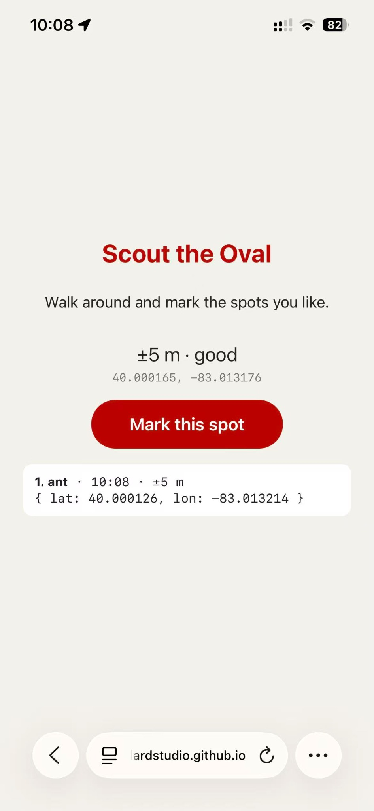

# Bounce & Echo

Hank Wang  
DESIGN 4106 — Intro to AR Training 2: Found on the Oval

Live page: https://buckeyenaggi-cyber.github.io/BIGWALK7.0/  
Repository: https://github.com/buckeyenaggi-cyber/BIGWALK7.0

The main inspiration for this project comes from Big Walk and other relaxed exploration games. I am drawn to experiences that encourage curiosity through walking, noticing unusual objects, and trying things out. Small interactions can make an ordinary space feel playful and worth exploring. I wanted to bring that feeling into AR by creating a few simple objects that participants discover through their own movement.

The Oval provides a real setting for this idea. People already walk through it, meet friends, and pause between classes. My project adds a small opportunity to stop and play along that everyday journey. The sound activity introduces the location gradually: participants compare directions and follow the stronger sound until they reach the project point. Requiring physical arrival makes finding the objects part of the experience. Their location gives participants a reason to pay attention to a particular part of the campus.

Once participants arrive, they find three activities: throwing a ball through a ring, releasing a pendulum to ring bells, and repeating a short sequence of notes. These actions are familiar enough to invite experimentation with very little explanation. Lights, sounds, and small streamers give immediate feedback and make each successful action feel noticeable.

Visually, I chose simple geometric forms, soft colors, and small bases that leave the real ground visible. I wanted the objects to feel like playful additions to the surroundings. The overall experience follows the relaxed pace that interests me in exploration games: participants can look around, approach an object, experiment, and enjoy a small discovery. Walking, listening, and touching become connected parts of the same activity.

Intent: I want people to slow down on the Oval and discover a small play space by listening and walking to it.

Project coordinates: **40.000126, -83.013214**  
Unlock radius: **20 metres**  
Sound trail start: **40.000211, -83.011224**, within 15 metres.

The project spot was saved on site as “ant.” The phone reported about ±5 m at capture. That is the saved reading, not a guarantee of AR accuracy.

The three simple objects are a throwing ring, a swinging weight with bells, and three note beacons. Their small bases leave the real ground visible. The interaction asks someone passing through the Oval to stop, listen, turn and move around one spot.

## Use

Open the live page on a phone and allow location. At the start, press Start and allow camera and motion access. Follow the louder sound to the project point. The objects stay locked until two location readings confirm arrival within 20 m. Press Enter; they appear automatically near the recorded coordinate once GPS, compass and visual ground tracking are ready. The participant does not choose their position.

Walk closer and touch an object: drag and release the ball, pull and release the pendulum, or repeat the note pattern. Lights, sound and small streamers mark progress. Once aligned, the field keeps its position in that session while the phone moves. GPS/compass error and visual tracking drift can still affect alignment.

For a desk check, add `?fake` or `?preview` to the URL. These are practice modes, not on-site evidence. `?camera` skips the sound trail but still requires arrival within 20 m of the actual project point. Use the normal URL for the assignment video.

## Screenshot

                                                                        const TARGET = { lat: 40.000126, lon: -83.013214 };

This is the coordinate capture. The on-site AR screenshot and the final screen recording still need to be added after testing this version on a phone.

## Models and code

The four editable meshes are in `models/`: `toss-station.glb`, `swing-station.glb`, `echo-station.glb` and `throw-ball.glb`. Each is under 5 MB. Units are metres; 1 unit = 1 m. They are procedural mesh models, generated by `tools/build_models.py`, and can be edited in Blender.

AI assisted with the JavaScript, coordinate conversion, physics, debugging and procedural mesh generation. Third-party runtime notices are preserved in `vendor/`.

Based on the [teacher’s starter](https://github.com/robillardstudio/geo-model-viewer-starter), with exploration and feedback inspired by [Big Walk](https://bigwalk.game/). [Technical notes and other source references](docs/technical-notes.md).

I used [geo-model-viewer-starter](https://github.com/robillardstudio/geo-model-viewer-starter) by robillardstudio as the starting point for GPS location and unlocking. The open-source tools [A-Frame](https://github.com/aframevr/aframe) and [Three.js](https://github.com/mrdoob/three.js) support the 3D models, rendering, and interactions. I also used [8th Wall’s A-Frame World Effects example](https://github.com/8thwall/aframe-world-effects-example) and its 8-Frame integration for the AR setup.

The project also uses 8th Wall’s proprietary SLAM engine for visual world tracking; this component is not open source. Big Walk inspired the exploration and playful feedback, but none of its code or assets were used.